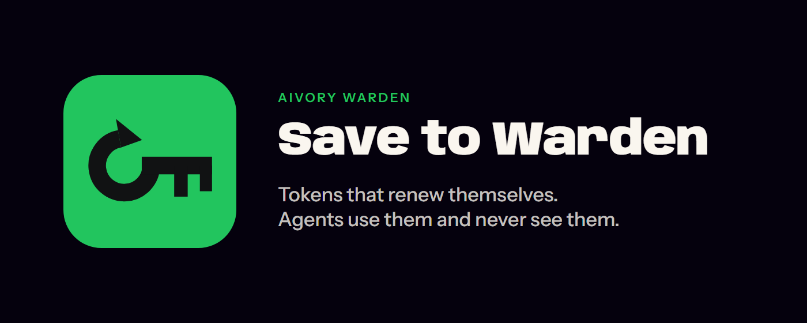
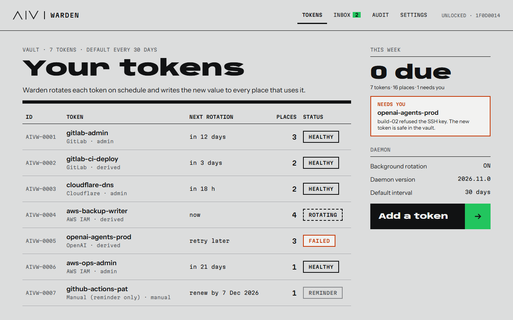
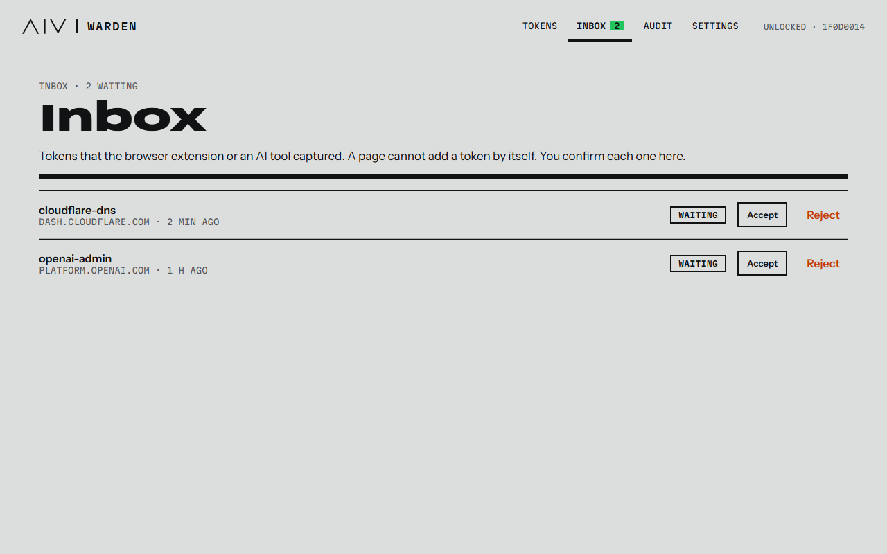

# Aivory Warden

<p align="center">
  <b>Your access tokens renew themselves.</b><br>
  Warden rotates your GitLab, AWS, Cloudflare and OpenAI tokens on a schedule. AI agents use them and never see them.
</p>

<p align="center">
  
</p>

<p align="center">
  <a href="#install"><b>Install</b></a> ·
  <a href="#connect-your-ai-tools">Connect your AI tools</a> ·
  <a href="#security-model">Security model</a> ·
  <a href="https://github.com/aivorynet/warden/issues">Issues</a> ·
  <a href="#buy-me-a-coffee">Buy Paul a coffee</a>
</p>

<p align="center">
  <a href="https://aivory.net/coffee/"></a>
</p>

Aivory Warden is a local, open-source token manager for Windows, macOS and Linux. It keeps your
tokens in an encrypted vault. A background daemon rotates them before they end, writes the new
value to every file, environment variable and SSH host that uses it, checks it, and revokes the
old one. Your AI agents call APIs through Warden's MCP server and never read a token.

The binary is `aivory-warden`. The short alias is `awd`. The desktop app sits in the tray.

Status: first public version. Windows is tested end to end, with a real GitLab rotation.
The macOS and Linux builds are a preview: they build and pass the tests in CI, but nobody has
used them on a real desktop yet. Website: [aivory.net/warden](https://aivory.net/warden/).

<p align="center">
  
  
</p>

## What it does

- **Rotates on a schedule.** Every 30 days by default, or your own interval per token, and always
  before the end date. GitLab, AWS IAM, Cloudflare, OpenAI, a custom command, or a reminder for a
  token that has no API. Admin tokens rotate themselves too.
- **Writes it where it is used.** dotenv, JSON, TOML and YAML keys, environment variables, and remote
  files over SSH. Atomic writes. Create, write, verify, then revoke: a failed place never breaks you.
- **Lets agents use, never read.** An agent calls an API through MCP. Warden adds the token, sends
  the request only to the hosts you allow, and removes the token from the answer.
- **Runs a command with a token:** `awd exec <name> -- <command>`.
- **Saves from the browser.** The "Save to Warden" extension sends a token from a provider page to
  your inbox. You confirm each one.
- **Stays quiet.** One note when something needs you, at most once a week per problem.

## Install

**Windows:**

```powershell
winget install Aivory.Warden
# or: scoop install aivory-warden
# or: irm https://github.com/aivorynet/warden/releases/latest/download/install.ps1 | iex
```

**macOS and Linux** (Homebrew):

```sh
brew install aivorynet/tap/aivory-warden
```

**macOS and Linux** (script, no package manager):

```sh
curl -fsSL https://github.com/aivorynet/warden/releases/latest/download/install.sh | sh
```

**Linux packages:** the `.deb` and the `.AppImage` on the
[releases page](https://github.com/aivorynet/warden/releases).

The scripts check the SHA-256 of the download against `SHA256SUMS`. Add `--service` (shell) or
`-Service` (PowerShell) to start the daemon at login, and `--extension` or `-Extension` to register
the browser native host. See [docs/INSTALL.md](docs/INSTALL.md) for all options.

The builds have no code signature yet. winget and Homebrew avoid the warnings. If you download an
installer from the releases page yourself, Windows SmartScreen warns at the first start
("More info" > "Run anyway"). On macOS, right-click the app and select "Open".

### Browser extension

"Save to Warden" is in review at the Chrome Web Store. Until it is live, load it by hand:
`edge://extensions` or `chrome://extensions` > Developer mode > Load unpacked > `extension/dist`.
Then run `awd extension install` once. See [extension/README.md](extension/README.md).

## Quick start

Open the desktop app, or use the CLI:

```sh
awd init       # create a vault, print the Emergency Kit, register this device
awd add        # add a token (asks for the missing values)
awd status     # show the daemon state and your tokens
```

Add a token with flags:

```sh
awd add --name "GitLab admin" --provider gitlab --expires 2027-06-01 \
  --interval 30d --sink dotenv:./.env:GITLAB_TOKEN
```

Other commands:

```sh
awd rotate --all      # rotate every token now
awd list              # list tokens
awd audit             # show the audit log
awd exec "GitLab admin" -- glab auth status
```

Run `awd --help` for all commands. Print the Emergency Kit when `awd init` shows it, and store it
somewhere safe. The vault needs your password and the Secret Key. Nobody can recover them for you.

## Connect your AI tools

Warden adds its MCP server to your AI tools for you. You do not edit a config file.

The desktop app shows "Connect your AI tools" after the Emergency Kit, and again in Settings >
MCP clients. Or use the command line:

```sh
awd mcp-setup                 # a checklist of the installed tools
awd mcp-setup --list          # show every tool and its state
awd mcp-setup --client cursor # connect one tool
awd mcp-setup --all           # connect every installed tool
awd mcp-setup --remove cursor # remove the entry and unpair the tool
```

Supported: Claude Code, Claude Desktop, OpenAI Codex CLI, Gemini CLI, Google Antigravity, Cursor,
VS Code and Windsurf.

- Each tool gets its own pairing token. Unpair one tool and keep the others.
- Warden keeps a `.bak` copy of the old config file, all other servers and keys, and TOML comments.
- Warden changes nothing when it cannot parse the file.
- Restart the tool after you connect it.

The tools and their limits are in [crates/warden-mcp/README.md](crates/warden-mcp/README.md).

## Security model

Warden protects your tokens at rest, in sync, and from the agents that you give an MCP connection.
It does not protect a machine that an attacker already controls. Details:
[docs/SECURITY-MODEL.md](docs/SECURITY-MODEL.md). Report a problem: [SECURITY.md](SECURITY.md).

What we promise:

- The vault is encrypted with a key from your password and a 128-bit Secret Key (Argon2id,
  XChaCha20-Poly1305). A synced or backed-up copy is not readable without both.
- Every change to the vault is signed and chained. A tampered or removed change is detected.
- No MCP tool returns a secret value. There is no `get_secret`.
- An MCP request goes only over HTTPS, only to the hosts that you allow for that token, with no
  redirects and no private addresses.
- The proxy removes the secret from the answer, also in base64, hex and URL-encoded form.
- Only your OS user can talk to the daemon. Every client needs a paired token with limited rights.

What we do not promise:

- We do not protect against malware that runs as your user, or an agent with shell access.
- By default the vault key sits in the OS keychain, so the daemon can rotate without you. Turn the
  cache off with `awd settings set keychain-cache off`; rotations then wait until you unlock.
- Redaction of API answers is best effort.
- We do not protect a token after you write it to a place that an agent can read.
- If you lose the password or the Secret Key, the vault is gone.

## Buy me a coffee

Warden is free and open source (MIT). No account, no trial, no locked feature. If it saves you
time, you can buy me a coffee:

<p>
  <a href="https://aivory.net/coffee/"></a><br>
  <a href="https://aivory.net/coffee/"><b>Buy Paul a coffee</b></a>
</p>

Warden uses an honor system and makes no network call for it: after a payment, answer "yes, it went
through" in the app or run `awd coffee --paid`. The coffee note never blocks a rotation, and
`awd settings set coffee-reminder off` turns it off. Details: [docs/coffee.md](docs/coffee.md).

## Join in

- **Found a bug?** [Open an issue](https://github.com/aivorynet/warden/issues/new?labels=bug). The steps to repeat it are perfect. Never paste a real token.
- **Missing a provider?** [Ask for it](https://github.com/aivorynet/warden/issues/new?labels=provider). A link to the provider's token API helps.
- **Want to code?** Pick an issue, or bring your own idea, and [open a pull request](https://github.com/aivorynet/warden/pulls). See [CONTRIBUTING.md](CONTRIBUTING.md).
- **Like it?** [Buy me a coffee](#buy-me-a-coffee), give a star, or write a short review. It helps a lot.

## Parts

| Part | What it does |
|---|---|
| `crates/aivory-warden` | The binary `aivory-warden` and alias `awd`: daemon, CLI, MCP, native host, service install |
| `crates/warden-core` | Item model, policy, token naming, secret types, errors, wire types |
| `crates/warden-vault` | Crypto, op log, merge, keychain cache, audit |
| `crates/warden-providers` | GitLab, AWS IAM, Cloudflare, OpenAI, command, manual |
| `crates/warden-sinks` | dotenv, JSON, TOML, YAML, env vars, SSH; atomic writes |
| `crates/warden-engine` | Rotation state machine, journal, scheduler |
| `crates/warden-ipc` | Unix socket / named pipe, peer checks, pairing |
| `crates/warden-mcp` | stdio MCP server |
| `crates/warden-native-host` | Native messaging host for the browser extension |
| `crates/warden-verify` | Quick unlock: Windows Hello, Touch ID, polkit |
| `crates/warden-coffee` | The honor-system coffee note |
| `apps/desktop` | Tauri 2 desktop app with tray |
| `extension/` | "Save to Warden" browser extension (Manifest V3) |
| `packaging/` | Install scripts, Homebrew, Scoop, winget |

## Build and test

```sh
cargo build --release -p aivory-warden           # CLI and daemon
cargo build --release -p aivory-warden-desktop   # desktop app (needs the Tauri system packages on Linux)
cargo test --workspace
cd extension && npm install && npm test
```

You need Rust 1.95 or newer. Every change passes `cargo fmt`, `cargo clippy -D warnings`,
`cargo test` and `cargo deny check`. Tests use synthetic tokens only.

## Documents

- [AGENTS.md](AGENTS.md): rules for coding agents and contributors.
- [docs/INSTALL.md](docs/INSTALL.md): all install options.
- [docs/SECURITY-MODEL.md](docs/SECURITY-MODEL.md): threat model.
- [docs/PLAN.md](docs/PLAN.md): the original spec.
- [CHANGELOG.md](CHANGELOG.md): changes.

## License

MIT. See [LICENSE](LICENSE).
